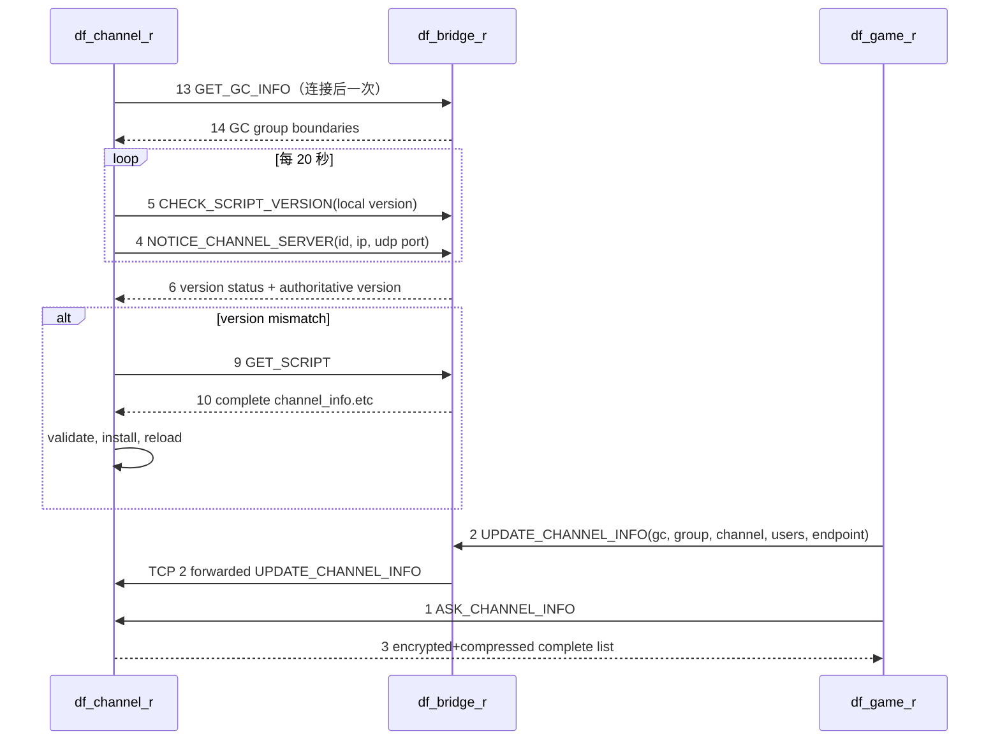

# df_channel_r 0828 可替换守护进程

这是从有符号的 32 位 ELF `artifacts/channel_0828/df_channel_r` 恢复出的可编译、可审计 C++11 Channel 守护进程。它保留官方 0828 wire 布局，并补齐旧交付缺少的 CLI、配置、daemon/PID、信号、四级日志、TCP/UDP 监听、Bridge 重连、状态淘汰和每日密钥轮换。

> 替换状态：源码和 Windows 核心回归已通过；生产替换仍以目标机 GCC 4.9/i386 的 `make test`、`readelf/ldd` 和隔离端口烟测全部通过为硬门。实现复刻可观察契约，不逐行复制旧 Neople Reactor、内存池或日志库。

## 快速构建

远端 GCC 4.9 环境：

```bash
cd df_channel_r
chmod +x build.sh
./build.sh
```

等价手动命令：

```bash
make clean all
make test CHANNEL_INFO=../artifacts/channel_0828/channel_info_0828_authoritative.etc
```

依赖开发包：

```bash
yum install gcc-c++ make openssl-devel zlib-devel
```

CMake 仅作为现代环境的备用入口：

```bash
cmake -S . -B build
cmake --build build
ctest --test-dir build --output-on-failure
```

构建输出包括：

- `df_channel_r`：可运行守护进程；
- `channel_core_test`：协议、频道表、严格 GC 门、40 秒淘汰及 DNF12 消息 17/18 压缩加密回环测试；
- `channel_daemon_integration_test`：真实进程、TCP/UDP bind、Bridge 转发、UDP 忽略与部分帧集成测试。

## 按原运维契约运行

命令行保持原版的 `<配置名> <动作>`：

```bash
cd /home/neople/channel
./df_channel_r channel start   # fork + ./pid/channel.pid
./df_channel_r channel stop    # SIGTERM + 等待退出
./df_channel_r channel run     # 前台运行，不写 PID
./df_channel_r channel test    # 原版兼容：同 run
./df_channel_r channel pause   # SIGUSR1；原版兼容 no-op
```

配置固定读取 `./cfg/<配置名>.cfg`。原版 `[server]` 七键全部必填：

```ini
[server]
id = 1
max_client = 1000
this_ip = 192.168.200.131
this_tcp_port = 7100
this_udp_port = 7100
bridge_ip = 127.0.0.1
bridge_port = 7000
```

`id` 必须大于 0，`this_ip` 最长 15 字节，端口必须为 1–65535，`max_client` 为 1–5000。可选
`allow_pending_before_gc = yes` 会缓存 SC14 之前到达的消息 2，并在 GC 表到达后发布；默认 `no`，严格匹配原版。

运行目录契约：

| 路径 | 用途 |
|---|---|
| `cfg/<name>.cfg` | 七键服务配置 |
| `pid/<name>.pid` | `start` 模式 PID 与进程锁 |
| `log/Info_<name>.log` | 常规启动、连接和维护日志 |
| `log/Warn_<name>.log` | 协议拒绝、断线和重连日志 |
| `log/Error_<name>.log` | Socket/事件循环错误 |
| `log/Cri_<name>.log` | 无法启动的致命错误 |
| `channel_info/channel_info.etc` | 权威频道脚本 |
| `channel_info/version` | 脚本版本 |

## 使用 0828 频道文件

原版 `ChannelScript::ReloadScript` 在 `0x0805210A` 固定读取相对路径：

```text
channel_info/channel_info.etc
```

版本文件固定为：

```text
channel_info/version
```

因此以 `/home/neople/channel` 为工作目录运行时，权威文件应位于：

```text
/home/neople/channel/channel_info/channel_info.etc
/home/neople/channel/channel_info/version
```

`ScriptStore` 按二进制字节完整保存/下发脚本，不从数据库重建，也不会丢弃 0828 新行。安装 Bridge 新脚本时先校验闭合的 `[dungeon]`/`[server]` 表和字段，再用临时文件替换脚本，最后替换版本文件。
频道行的 `exp_rate` 与 `exp_1..exp_10` 均按有限浮点数解析，因此 Bridge writer 输出的 `0.0` 可直接通过热更校验；频道号和类型仍严格要求整数。
启动时会确定性处理固定 `.rollback/.new`：主 script/version 有效则清理遗留文件；主 pair 缺失或无效且 rollback pair 完整有效时复制回滚旧 pair，验证成功后再清理，进程在恢复中途退出也可于下次启动重试。

## 频道类型行为

| 类型 | 用途 | 本恢复核心 |
|---:|---|---|
| 3 | 交易/拍卖 | 非 PvP |
| 19 | Zombie 感染地区 A/B/C | 支持，刻意不归普通 PvP |
| 20 | Tournament | 支持，归 PvP |
| 21 | 无效哨兵 | 拒绝进入频道表 |
| 22 | 保留值 | 拒绝进入频道表 |
| 23 | Raid 团本 | 支持，独立于 PvP 分类 |

完整集合与上游工程保持一致：`IsPvpChannel` 包含 `4,5,6,7,8,9,10,13,14,15,16,20`；Zombie 19 和 Raid 23 独立。

## Wire 兼容表

所有整数沿用 x86 小端序，结构采用 `#pragma pack(1)`：

| 消息 | 分类/ID | 大小/正文 |
|---|---|---|
| 请求头 | 123 | 11 字节 |
| 响应头 | 124 | 11 字节 |
| `CS_ASK_CHANNEL_INFO` | 123/1 | 11 |
| `CS_UPDATE_CHANNEL_INFO` | 123/2 | 51 |
| `SC_ASK_CHANNEL_INFO` | 124/3 | 15 + 每组 24 + 每频道 48 |
| `CS_NOTICE_CHANNEL_SERVER` | 123/4 | 35 |
| `CS_CHECK_SCRIPT_VERSION` | 123/5 | 27 |
| `SC_CHECK_SCRIPT_VERSION` | 124/6 | 31 |
| `CS/SC_GET_SCRIPT` | 123/9、124/10 | 11 + 可变正文 |
| `CS/SC_CONNECT` | 123/11、124/12 | 27、47 |
| `CS_GET_GC_INFO` | 123/13 | 11 |
| `SC_GET_GC_INFO` | 124/14 | 15 + `count × 24` |
| `CS_GET_SERVER_GROUP_CHANNEL_INFO` | 0/17 | 35 = 11 + `name[20]` + `u32 parser_group` |
| `SC_GET_SERVER_GROUP_CHANNEL_INFO` | 124/18 | 11 + zlib(AES(`u16 fallback + u32 count + count × 48`)) |

游戏端响应沿用原顺序：

```text
版本正文        -> AES-128-ECB/零填充
频道列表正文    -> AES-128-ECB/零填充 -> zlib level 1
完整脚本正文    -> AES-128-ECB/零填充 -> zlib default
大区频道正文18  -> AES-128-ECB/零填充 -> zlib best compression
```

Bridge 到 Channel 的 GC、版本和脚本响应保持原始明文 wire；脚本正文由 `BridgeProtocolClient` 原样写入 `ScriptStore`。

## 源码结构

| 文件 | 职责 |
|---|---|
| `include/channel/protocol.hpp` | packed wire 结构、消息/频道类型枚举 |
| `src/protocol.cpp` | 头校验、序列化、0828 PvP 类型判定 |
| `src/script_store.cpp` | 完整脚本与版本读取、15 字段/闭合块校验、Bridge 双文件回滚更新 |
| `src/channel_registry.cpp` | GC 边界、频道在线信息、频道列表序列化 |
| `src/legacy_codec.cpp` | OpenSSL AES 与 zlib 的官方 wire 组合 |
| `src/channel_service.cpp` | 游戏侧 CONNECT/版本/脚本/列表/更新处理 |
| `src/channel_client.cpp` | Bridge 初始请求、响应处理及 POSIX TCP 传输 |
| `src/daemon_config.cpp` | 原版 `[server]` 七键配置解析与路径契约 |
| `src/channel_daemon.cpp` | CLI/daemon/PID/信号/日志、TCP/UDP、Bridge 与维护循环 |
| `src/main.cpp` | `df_channel_r` 可执行入口 |
| `tests/channel_daemon_integration_test.cpp` | Mock Bridge + 真实进程端到端测试 |
| `tools/dwarf_inspect.py` | 可复现的 DWARF/符号/Capstone 证据提取 |

## Bridge 连接顺序



## 兼容说明

- 原版用 Bridge GC 上界寻找分组：`1 <= upper_gc - incoming_gc <= 999`；此规则被保留。
- 默认严格复刻原版：SC14 建立 GC 表前拒绝消息 2；`group_hint` 不参与 GC 归组。可选兼容模式只缓存早到更新，仍等待权威 GC 表后再发布，避免把逻辑 `server_group=17` 错当 GC 数组下标。
- SC14 必须包含 1–128 条记录、非空组名和正数 `upper_gc`。记录严格保留 Bridge wire 顺序，不做数值排序或去重；真实表受 VARCHAR 排序影响可呈 `10000,100000,2000,...`，归组仍按收到顺序执行首个 `1..999` 差值命中。每次新建 Bridge 连接后 5 秒内收不到有效 SC14 会主动断线并按 1 秒周期重连。
- 游戏侧频道名仍按原版生成 `#ch.<channel_no>`。DNF12 消息 18 只传数字频道引用与运行时端点；显示名和类型由客户端本地 CN PVF `etc/channel_info.etc` 的 `channel_info_dname_*` / `chn_channel_info_*` 数据解析。
- CN 大区 1 的消息 17 必须使用 `parser_server_group=1` 与 `server_group_name=cain`；265 是 `SERVER_GROUP_TYPE_MAX`，客户端会在解析消息 18 前拒绝。
- `checksum` 保持原版值 0，`ack` 在响应中设为 1。
- Bridge 断线每 1 秒重连；同一 Bridge TCP 流可接收 14/6/10 和转发的 category 123 / id 2。
- UDP 端口按原版绑定，但 `registerProtocolsExtra` 为空，默认排空并忽略数据；消息 2 只接受 Bridge 同一 TCP 连接的转发，不扩大未认证入口。
- TCP 流按 11 字节头处理拆包/粘包和部分写，单帧上限 `0xA0000`；客户端上限来自配置。
- Game 状态超过 40 秒未更新即移除；TCP 会话 10 分钟无活动关闭；本地日期变化时轮换时间戳 AES key。
- ASK_CHANNEL_INFO 的组数与正文来自同一份 registry snapshot，避免并发更新造成 count/body 不一致。
- `stop/pause` 只向持有 PID 文件 flock 且 `/proc/<pid>/exe` basename 为 `df_channel_r` 的进程发信号；PID 文件由守护进程先 unlink、再解锁和关闭，避免 PID 复用误杀与路径竞态。

Channel 本身不连接 MySQL，也不链接 `libmysqlclient`。`d_channel` 与 MySQL 5.5.27 客户端 ABI 属于 Bridge 契约；Channel 运行依赖为 32 位 `libcrypto.so.1.0.0`、`libz.so.1`、pthread 和目标机 C++ 运行库。

## 替换前验收

```bash
cd /root/oldsrv_service_restore_0828/df_channel_r
make clean all
make test CHANNEL_INFO=/home/neople/channel/channel_info/channel_info.etc
file ./df_channel_r
readelf -h -d -V ./df_channel_r
ldd ./df_channel_r
```

必须确认：ELF32/i386、解释器 `/lib/ld-linux.so.2`、所有依赖可解析、两项测试均 PASS。随后先在隔离 TCP/UDP 端口运行 `test`，验证 Bridge 13→14、周期 5/4、TCP 转发消息 2、UDP 无业务分发、Game CONNECT/1/3，并验证 CN 客户端 17→18 后能得到频道 11/200，再备份原二进制并按现有 supervisor 切换。

详细证据见 [0828 逆向恢复报告](docs/2026-08-18_reverse-df_channel_r-report.md) 与 [DNF12 消息 17/18 报告](docs/2026-08-27_reverse-DNF12-channel-msg17-18-report.md)。
